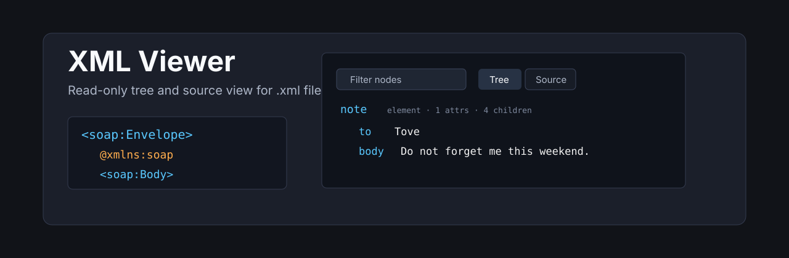
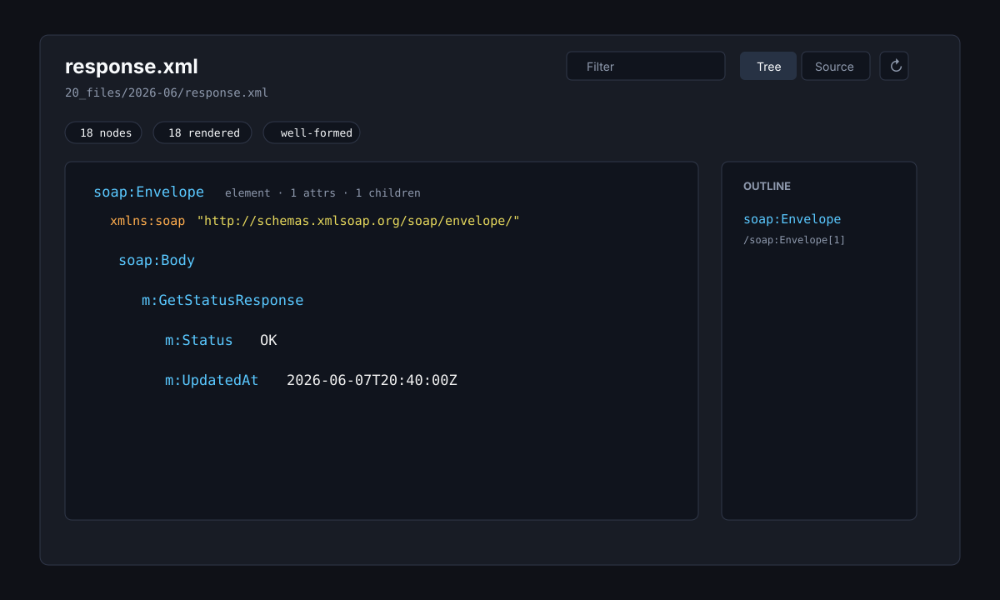

<p align="center">
  
</p>

<p align="center">
  <a href="https://github.com/viggomeesters/obsidian-xml-viewer/releases/latest"></a>
  <a href="LICENSE"></a>
  
  
</p>

# XML Viewer

XML Viewer is a read-only plugin for browsing `.xml` files as a structured tree and syntax-highlighted source. It is built for AI-generated XML, SOAP payloads, config exports, sitemaps, integration files, and quick inspection of XML without leaving the vault.



## Features

- Opens `.xml` files in a dedicated view.
- Shows a tree view by default.
- Provides a source view with line numbers and lightweight XML syntax highlighting.
- Filters visible nodes by element names, attribute names, attribute values, text, comments, and CDATA.
- Shows element names, attributes, namespace prefixes, child counts, text previews, and node paths.
- Renders comments, CDATA, processing instructions, document type nodes, text nodes, and attributes distinctly.
- Includes a compact outline for top-level elements.
- Reports malformed XML without crashing and keeps the source view available.
- Applies a 10,000 node render cap to keep large XML files responsive.
- Stays read-only by design: it never writes back to XML files.

## Large files

XML files can become large quickly, especially generated SOAP payloads and config exports. XML Viewer renders the first 10,000 nodes to keep the view responsive. Additional nodes are counted and reported in the warning area.

## Privacy and security

XML Viewer does not make network requests and does not send vault content to external services. It does not use the system clipboard. It reads files through the vault API and renders a local view.

The plugin parses XML locally with the runtime `DOMParser`. It does not execute XSLT, does not validate XSD or DTD files, and does not intentionally resolve external entities or resources.

## Why read-only?

XML editing can easily damage whitespace, entity escaping, comments, CDATA, processing instructions, and schema-sensitive element ordering. XML Viewer intentionally avoids writing to disk in v0.1.

## Installation

### Community plugin directory

Install from the [Obsidian Community directory](https://community.obsidian.md/plugins/xml-viewer) or search for XML Viewer in Settings → Community plugins → Browse.

### Manual installation

1. Download `main.js`, `manifest.json`, and `styles.css` from the [latest release](https://github.com/viggomeesters/obsidian-xml-viewer/releases/latest).
2. Create this folder in your vault: `.obsidian/plugins/xml-viewer/`.
3. Put the downloaded files in that folder.
4. Reload the app.
5. Enable **XML Viewer** in **Settings -> Community plugins**.

### BRAT installation

For beta testing, install the plugin with [BRAT](https://github.com/TfTHacker/obsidian42-brat) using this repository URL:

```text
https://github.com/viggomeesters/obsidian-xml-viewer
```

## Usage

Open any `.xml` file in your vault. The file opens with XML Viewer.

Use the toolbar to:

- filter visible nodes
- switch between tree and source views
- refresh the file after external changes

Malformed XML automatically shows the parse warning and source view so the raw file remains inspectable.

## Development

```bash
npm install
npm run build
npx tsc --noEmit
npm test
```

For local development, copy or symlink this repository into `.obsidian/plugins/xml-viewer/` inside a test vault.

## Release process

Community plugin files are installed from GitHub releases. For each release:

1. Update `manifest.json`, `package.json`, and `versions.json`.
2. Run `npm install`, `npm run build`, `npx tsc --noEmit`, and `npm test`.
3. Create a GitHub release whose tag exactly matches `manifest.json.version`.
4. Attach `main.js`, `manifest.json`, and `styles.css` as release assets.

The repository includes a GitHub Actions release workflow with artifact attestation support. If GitHub Actions is disabled for the owner account, manual releases are still usable, but automated review may show a recommendation about missing artifact attestations.

## Community directory

XML Viewer is listed in the [Obsidian Community directory](https://community.obsidian.md/plugins/xml-viewer).

## License

[MIT](LICENSE)
